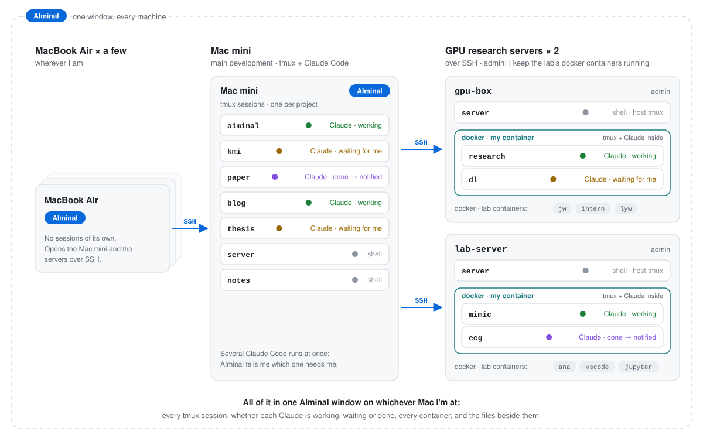
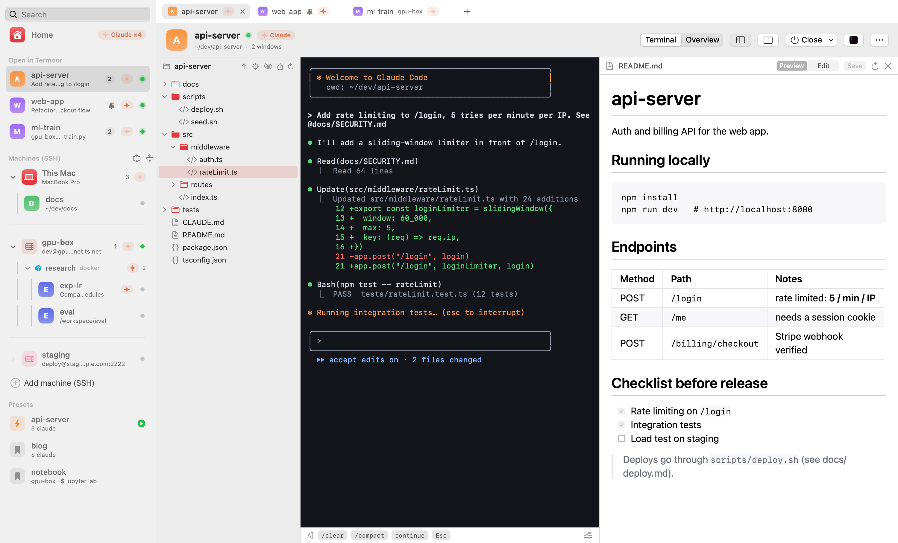
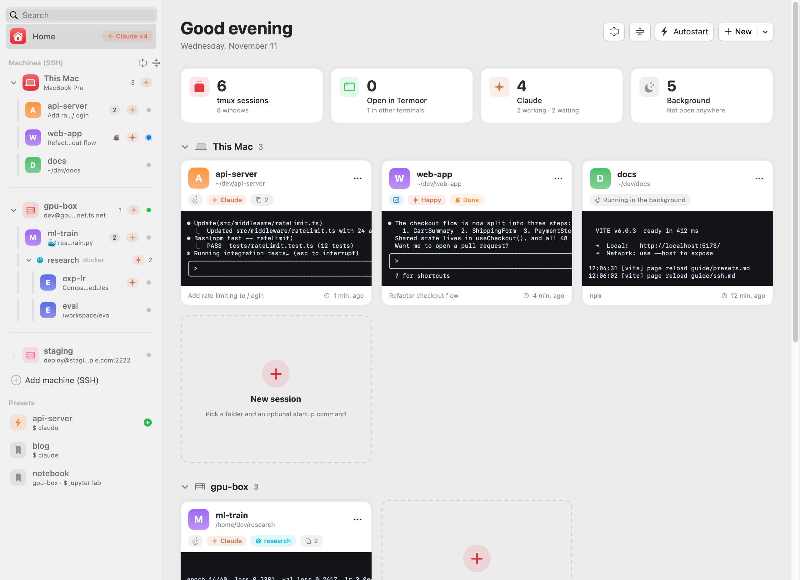
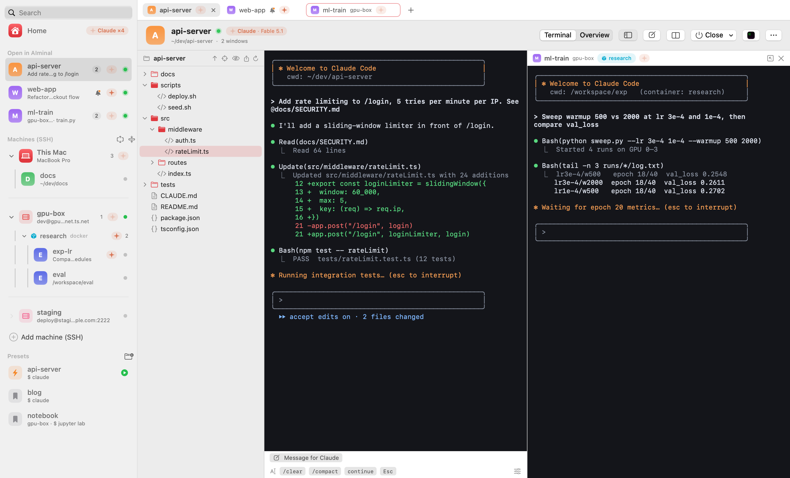
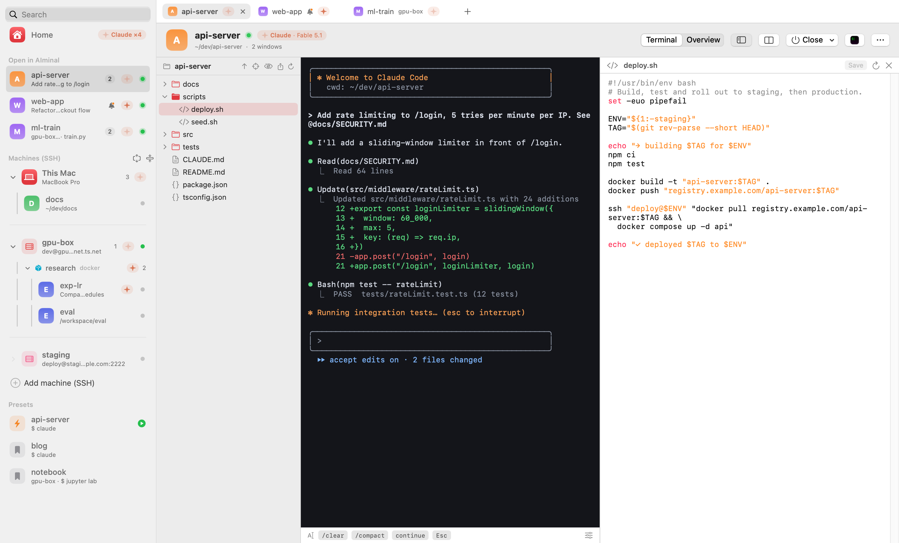
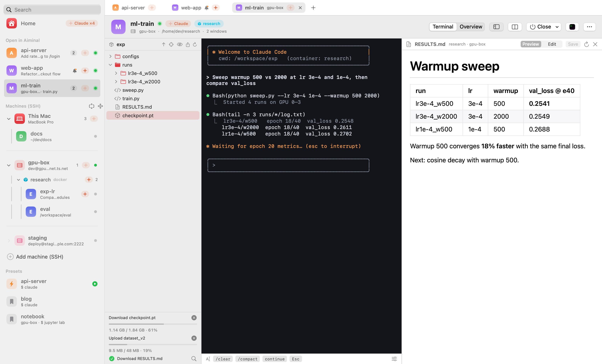
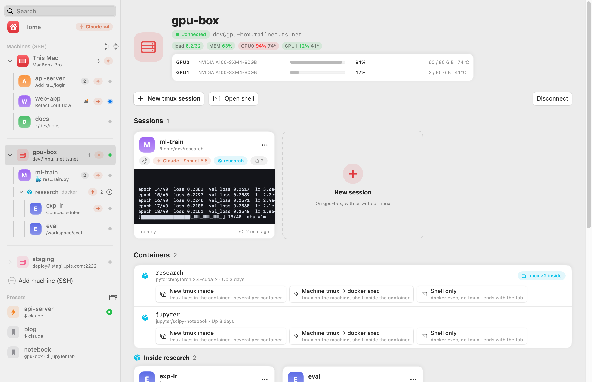
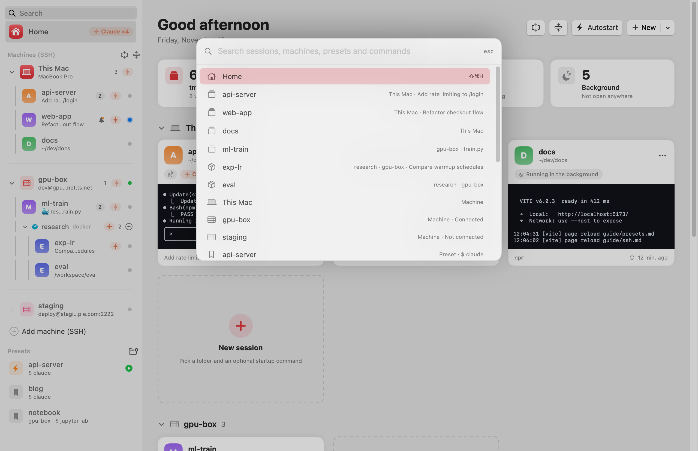

# AIminal

[English](README.md) | **한국어**

**여러 머신에서 여러 tmux 세션을, 그 안에서 여러 Claude Code를 돌리는 사람을 위한 macOS 터미널.** 내 Mac, SSH 서버, 그 안의 docker 컨테이너에 흩어진 세션을 한 창에서 보고, Claude가 끝나는 순간을 알고, 터미널을 나란히 열고, 앱을 떠나지 않고 원격 파일을 보고·고치고·내려받고·올립니다.

> 상태: **공개 베타**, 베타 기간에는 무료. · 📖 **[사용설명서](GUIDE.ko.md)** · **[Guide (English)](GUIDE.md)**

> **Termoor가 AIminal로 이름을 바꿨습니다.** 같은 앱, 새 이름입니다(0.11에서는 "Aiminal"로 썼고, 0.10 전에는 Initia였습니다). Aiminal·Termoor·Initia가 설치돼 있으면 스스로 AIminal로 업데이트되고, 설정·프리셋·열린 탭은 그대로 이어집니다.

<picture>
  <source media="(prefers-color-scheme: dark)" srcset="screenshots/setup-dark.svg">
  
</picture>

<picture>
  <source media="(prefers-color-scheme: dark)" srcset="screenshots/files-dark.png">
  
</picture>

## 핵심 기능

| | |
|---|---|
| 🏠 **모든 tmux 세션의 홈** | 이 Mac, SSH 서버, 그 안의 docker 컨테이너에 있는 모든 세션을 한 창에 실시간 카드로 |
| 🤖 **Claude Code가 끝나면 알려줌** | 작업 중·대기 중·사용 한도 도달(풀리는 시간까지)과 어떤 모델인지까지 구분. 원격 서버나 컨테이너 안이라도 끝나는 순간 알림 |
| ✍️ **여러 줄 프롬프트** | ⇧⌘M으로 터미널 아래에 글상자. 마크다운·코드 블록이 든 긴 프롬프트를 쓰고 미리 본 뒤 ⌘↩로 Claude에게 메시지 하나로 |
| 🗂 **터미널 옆 파일 트리** | ⇧⌘E. 세션의 폴더를 따라감. Mac·서버·컨테이너 모두. 파일을 오른쪽 클릭해 Claude에게 `@경로`로 넘기기 |
| ✏️ **vim 없이 파일 편집** | `.md`, `.html`, `.sh`, `.py`, `.json`, `.yaml`… 더블클릭하면 터미널 옆에 구문 색상과 함께 열림. Markdown·HTML 미리보기, ⌘S로 서버에 바로 저장 |
| ⬇️⬆️ **다운로드와 업로드** | 오른쪽 클릭으로 파일·폴더를 원하는 폴더에 내려받고, Finder에서 끌어다 올리기. 크기·퍼센트 진행률과 취소 버튼 |
| 🪟 **터미널 나란히** | ⌘D, 나누기 버튼, 또는 탭을 터미널 위로 드래그. 좌우 또는 위아래. 두 서버의 Claude를 동시에 지켜보기 |
| 🐳 **docker 컨테이너도 일급** | 컨테이너에 대신 들어가고, 그 안의 tmux 세션을 찾아 탭으로 열어줌 |
| 🔐 **서버에 부담 없는 SSH** | `~/.ssh/config`를 그대로 사용, 키·비밀번호 모두, 머신당 연결 하나를 공유. 서버에 설치할 것 없음 |

## 화면으로 보기

### 모든 세션, 하나의 홈
내 Mac, 서버, 그 안의 컨테이너에 있는 모든 tmux 세션을 실시간 카드로. 각각의 Claude 상태와, 끝난 세션에는 🔔.

<picture>
  <source media="(prefers-color-scheme: dark)" srcset="screenshots/home-dark.png">
  
</picture>

### 두 머신을 나란히
내 Mac의 Claude와 GPU 서버 컨테이너 안의 Claude를 옆에 나란히. 탭을 터미널 위로 끌거나, ⌘D를 누르거나, 나누기 버튼을 쓰면 됩니다.

<picture>
  <source media="(prefers-color-scheme: dark)" srcset="screenshots/split-dark.png">
  
</picture>

### vim 없이 편집
파일 트리에서 스크립트나 설정 파일을 더블클릭해 터미널 옆에서 구문 색상과 함께 고치고, ⌘S로 서버에 바로 저장.

<picture>
  <source media="(prefers-color-scheme: dark)" srcset="screenshots/editor-dark.png">
  
</picture>

### 서버에서 결과 가져오기
컨테이너에서 체크포인트나 폴더 전체를 진행률과 함께 내려받고, Finder에서 파일을 떨어뜨려 올리고, 결과는 렌더링된 Markdown으로 읽기.

<picture>
  <source media="(prefers-color-scheme: dark)" srcset="screenshots/transfer-dark.png">
  
</picture>

<table>
<tr>
<td><picture>
  <source media="(prefers-color-scheme: dark)" srcset="screenshots/ssh-host-dark.png">
  
</picture></td>
<td><picture>
  <source media="(prefers-color-scheme: dark)" srcset="screenshots/palette-dark.png">
  
</picture></td>
</tr>
<tr>
<td align="center"><code>~/.ssh/config</code>의 머신들</td>
<td align="center">⌘K로 어디든 바로 이동</td>
</tr>
</table>

## 왜 만들었나

제 하루는 tmux 위에서 돌아가는데, 터미널 창 하나로 감당하기엔 머신이 너무 많습니다. 실제 제 환경은 이렇습니다(이 페이지 맨 위 그림):

- **Mac mini 한 대**가 주 개발 머신. 프로젝트마다 tmux 세션이 하나씩 있고, 그중 여러 개가 동시에 Claude Code를 돌립니다
- **MacBook Air 여러 대**는 밖에서 일할 때용. 자기 세션은 없고 SSH로 Mac mini와 서버들에 붙으니, 실제 작업은 늘 그쪽에 남아 있습니다
- **GPU 연구 서버 두 대**에는 SSH로. 관리자라서 호스트에 tmux 하나, 그리고 연구실 사람들을 위해 띄워 둔 docker 컨테이너 여러 개가 있고 컨테이너마다 그 안에 또 tmux가 있습니다. 제 연구는 제 컨테이너 안에서 tmux + Claude Code로 합니다

보통 터미널에서는 이 모든 관리를 손으로 해야 했습니다. 어느 세션이 어느 머신, 어느 컨테이너 안에 있지? 저 세션의 Claude는 끝났나, 아직 돌고 있나, 내 답을 기다리나? 그 프로젝트의 폴더와 명령이 뭐였더라? `ssh`, `docker exec`, `tmux ls`, `tmux attach -t …`를 계속 반복해서 치고 있었습니다.

AIminal은 그래서 만든 앱입니다:

- **tmux 세션을 편하게 관리.** 모든 세션이 실시간 미리보기가 있는 카드. 열기·이름 바꾸기·창 나누기·닫기를 클릭 한 번에. 탭을 닫아도 작업은 절대 죽지 않음
- **매일 시작하는 것은 프리셋으로.** 머신 + 폴더 + 시작 명령(예: `claude`)이 클릭 한 번이 되고, AIminal이 켜질 때 알아서 시작할 수도 있음
- **Claude가 끝나면 알기.** 어느 세션이 Claude Code를 돌리는지, 작업 중인지 대기 중인지 보고, 끝나면 알림. 원격 서버라도
- **여러 머신, 한 창.** `~/.ssh/config`의 머신들이 이 Mac 옆에 나란히. 리눅스 서버든 다른 Mac이든. 한 번 연결하면 각 머신에서 도는 모든 tmux 세션이 보이고, 어느 것이든 탭으로 열림
- **그 안의 컨테이너까지.** 실제 작업은 한 단계 더 안쪽, 서버의 docker 컨테이너에서 일어나곤 합니다. AIminal은 tmux는 서버에 두고 컨테이너에는 대신 들어가며, 그 안의 Claude가 끝나는 것도 압니다
- **터미널이 아니라 홈.** 지금 돌아가는 모든 것의 개요에서 시작해, AIminal의 터미널로 바로 들어가기

## 기능

- **홈**: 세션마다 카드, 실시간 미리보기, 지금 돌아가는 것의 요약이 있는 시작 화면
- **내장 터미널**: 어떤 tmux 세션이든 AIminal 안의 진짜 터미널에서 탭으로 열기. tmux 없는 일반 터미널도 가능(⌘T)
- **명확한 닫기 동작**: 창 닫기(Ctrl-b d)는 세션을 계속 돌리고, Claude 종료(/exit)는 Claude만 끝내고, tmux 세션 종료는 전부 끝냄
- **키보드 우선**: ⌘를 누르고 있으면 모든 단축키가 보이고, ⌘K로 세션·머신·명령 어디로든, ⌘1…⌘9로 탭, ⌘= / ⌘-로 터미널 확대·축소
- **Claude Code 인식**: 어느 세션이 Claude(또는 `happy claude`)를 돌리는지, 작업 중인지 대기 중인지, docker 컨테이너 안이라도 보임. Claude가 끝나거나 사용 한도에 걸리면(풀리는 시간과 함께) 알림, Claude마다 어떤 모델을 쓰는지(**Claude · Fable 5.1**)와 머신마다 어떤 계정·플랜으로 로그인돼 있는지 표시, **Claude 종료(/exit)**로 깔끔하게 끝내기
- **머신**: 이 Mac과 `~/.ssh/config`의 머신들이 사이드바에 나란히. 연결(키 또는 비밀번호)하면 각 머신의 tmux 세션을 보고 열 수 있고, 머신 추가·편집도 앱 안에서. 머신당 SSH 세션 하나만 유지하므로 서버에는 로그인 한 번으로 보임
- **docker 컨테이너**: tmux는 서버에 두고 작업은 컨테이너 안에서. 세션이나 프리셋에 컨테이너를 지정하면 AIminal이 `docker exec`로 대신 들어감(폴더와 시작 명령까지). 컨테이너 *안에서* 도는 tmux 세션도 찾아 `docker exec -it <컨테이너> tmux attach`로 열어줌. 머신 화면에 실행 중인 컨테이너 목록
- **파일 트리**(⇧⌘E, 기본 표시): 세션의 폴더를 따라가는 폴더 트리가 터미널 옆에. 이 Mac, SSH 머신, 컨테이너 안 모두. 파일을 오른쪽 클릭해 경로를 터미널에 넣기(Claude에는 `@경로`). 파일·폴더 다운로드, Finder에서 끌어다 업로드, 진행률과 취소
- **내장 편집기**(구문 색상): 텍스트 파일(`.md`, `.html`, `.sh`, `.py`, `.json`, `.yaml`, …)을 더블클릭하면 터미널 옆에 열림. Markdown·HTML은 실시간 미리보기. ⌘S로 머신이나 컨테이너에 다시 저장하고, 연 뒤 파일이 바뀌었으면 경고. 그 밖의 파일은 해당 앱으로, SSH 머신이면 VS Code Remote로
- **나란히 보기**: ⌘D로 지금 터미널 옆에 새 터미널(⇧⌘D는 아래). 머리줄의 나누기 버튼으로 어떤 탭이나 세션이든 옆에 열고, 탭을 터미널 위로 드래그해도 됨. 터미널과 파일을 최대 네 개까지, 좌우 또는 위아래로
- **여러 줄 입력**(⇧⌘M): 터미널 아래 글상자에 마크다운·코드 블록이 든 긴 프롬프트를 쓰고, 미리 본 뒤 ⌘↩로 Claude에게 메시지 하나로 보내기
- **스니펫**: 터미널 아래 버튼 한 번으로 글자 입력(`/clear`, `/compact`, …)
- **tmux 관리**: 세션 만들기, 세션·창 이름 바꾸기, 창 만들기·닫기
- **기본은 AIminal에서 열기**, iTerm2·Terminal·cmux·Ghostty·WezTerm·kitty·Alacritty로도 클릭 한 번에
- **프리셋과 자동 시작**: 머신·폴더·시작 명령을 저장해 두고, 로그인 때 세션을 띄우기. iCloud Drive에 Mac마다 파일로 두고 다른 Mac의 프리셋을 한 번에 읽어 오기
- **자동 업데이트**: 새 버전을 확인해 클릭 한 번에 업데이트. tmux 세션은 계속 돌아감
- **메뉴 바와 Dock**, 영어·한국어 UI

## 설치

macOS 15 이상(Apple Silicon 또는 Intel)과 [tmux](https://github.com/tmux/tmux)(`brew install tmux`)가 필요합니다.

```sh
curl -fsSL https://raw.githubusercontent.com/hyeok-jong/AIminal/beta/install.sh | bash
```

스크립트는 최신 릴리스를 내려받아 체크섬을 확인하고 `/Applications`(또는 `~/Applications`)에 AIminal을 설치합니다.

**수동 설치:** [Releases](https://github.com/hyeok-jong/AIminal/releases)에서 `AIminal-<버전>.zip`을 받아 `/Applications`에 풉니다. AIminal은 아직 Apple 공증을 받지 않아 첫 실행이 막힙니다. **시스템 설정 → 개인정보 보호 및 보안 → 그래도 열기**로 허용하거나, 다음을 실행하세요:

```sh
xattr -dr com.apple.quarantine /Applications/AIminal.app
```

## 프리셋

프리셋은 자주 시작하는 세션입니다: 머신, 폴더, 시작 명령. 홈에서 클릭 한 번으로 시작하거나, **자동 시작**으로 표시해 AIminal이 켜질 때 띄웁니다. 새로 설치하면 홈 폴더에서 Claude Code를 여는 `example` 프리셋이 들어 있습니다. 사이드바에서 고치거나 지우면 됩니다.

프리셋은 `~/.config/aiminal/config.json`에 저장되므로 직접 써도 됩니다:

```json
"presets": [
  { "name": "api-server", "path": "~/dev/api-server", "command": "claude", "autostart": true },
  { "name": "notebook", "path": "~/research", "command": "jupyter lab", "device": "gpu-box" },
  { "name": "train", "path": "/workspace/train", "command": "claude", "device": "gpu-box", "container": "research" }
]
```

`device`는 `~/.ssh/config`의 `Host` 이름입니다. 이 Mac이면 빼면 됩니다. `container`를 쓰면 tmux는 머신에 남고 세션은 `docker exec -it -w <path> <container> bash -lc '<command>; exec bash -l'`로 실행되므로, `path`는 컨테이너 안의 폴더입니다.

## 설정

설정은 `~/.config/aiminal/config.json`에 있습니다. 설정 창은 ⌘,로 엽니다.

**로그:** 오류와 경고는 `~/Library/Logs/AIminal/aiminal.log`에 남습니다. 로그 창은 ⇧⌘L.

**SSH:** AIminal은 `~/.ssh/config`에서 호스트를 읽습니다. 앱에서 호스트를 고치면 바뀐 줄만 다시 쓰고, 이전 파일은 `~/.ssh/config.aiminal-backup`으로 남깁니다. 비밀번호는 절대 저장하지 않습니다. 비밀번호가 필요한 호스트는 터미널 탭에서 한 번 로그인하면 그 연결을 30분 동안 다시 씁니다.

**cmux:** cmux는 기본적으로 자기가 띄운 프로세스의 소켓 연결만 받습니다. AIminal이 cmux에 워크스페이스를 열게 하려면 cmux **Settings → Automation**에서 소켓 접근을 `password`로 바꾸고, 같은 비밀번호를 AIminal의 **설정 → 터미널**에 넣으세요.

## 피드백

버그 신고와 기능 요청은 [Issues](https://github.com/hyeok-jong/AIminal/issues)에 남겨 주세요.

## 라이선스

AIminal은 독점 소프트웨어이며 베타 기간에는 무료로 쓸 수 있습니다. [LICENSE](LICENSE)를 보세요.
