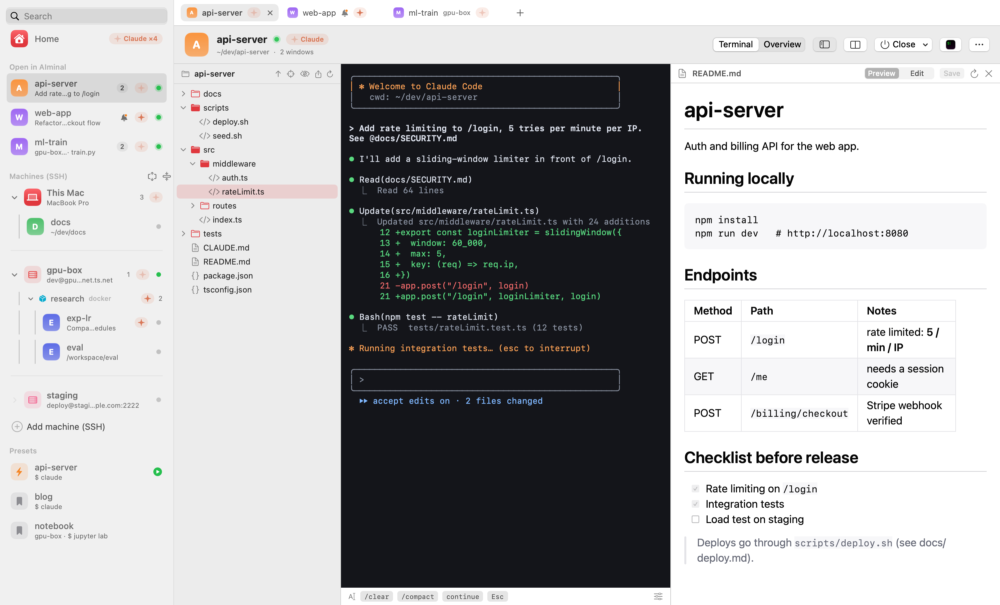
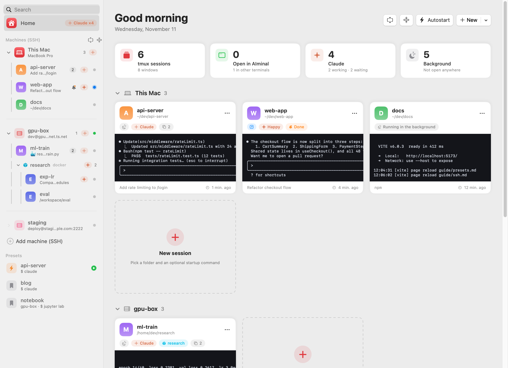
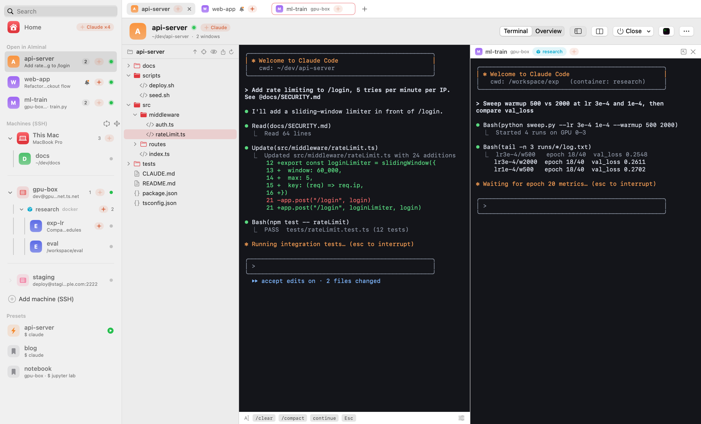
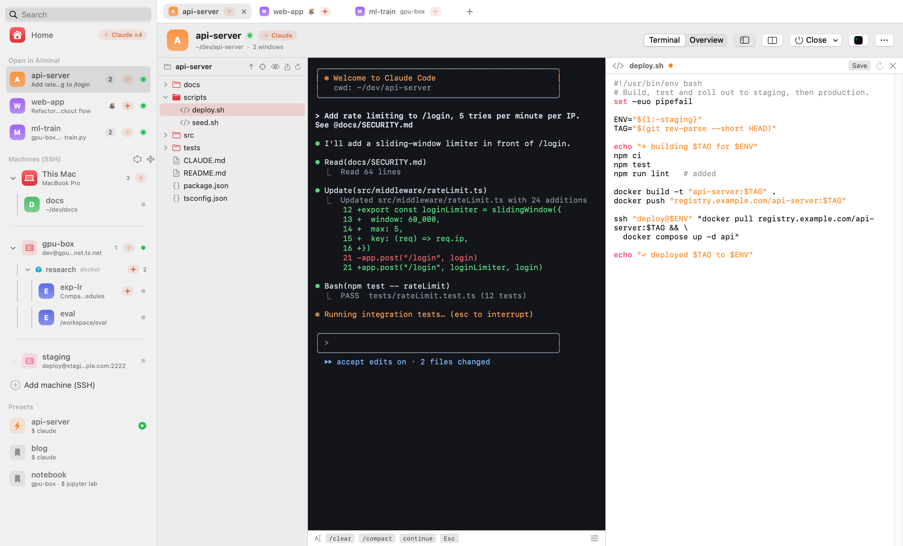
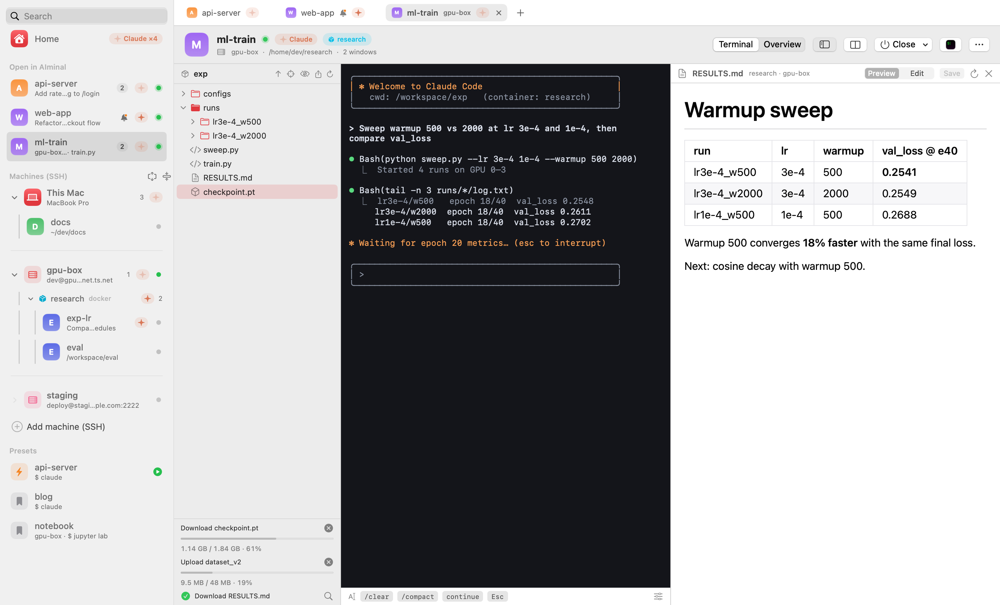
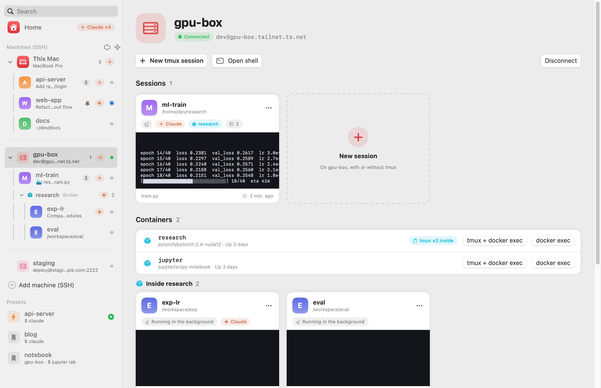
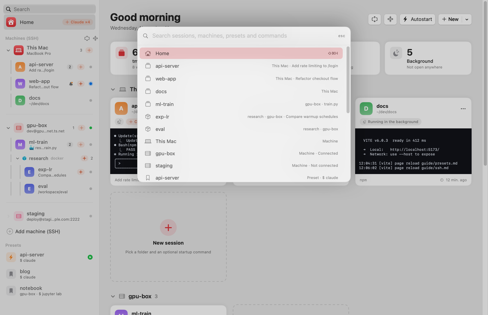

# AIminal

**English** | [한국어](README.ko.md)

**The macOS terminal for people who run many tmux sessions, on many machines, with many Claude Codes.** See every session on your Mac, your servers and their docker containers in one window, know the moment Claude is done, open terminals side by side, and browse, edit, download and upload remote files without leaving the app.

> Status: **public beta**, free during the beta. · 📖 **[Guide](GUIDE.md)** · **[한국어 README](README.ko.md)** · **[한국어 사용설명서](GUIDE.ko.md)**

> **Termoor is now AIminal.** Same app, new name (spelled "Aiminal" in 0.11, and called Initia before 0.10): if you have Aiminal, Termoor or Initia installed, it updates itself to AIminal and keeps your settings, presets and open tabs.

<picture>
  <source media="(prefers-color-scheme: dark)" srcset="screenshots/files-dark.png">
  
</picture>

## Highlights

| | |
|---|---|
| 🏠 **A home for all your tmux sessions** | Every session on this Mac, your SSH servers and the docker containers on them, as live cards in one window |
| 🤖 **Knows when Claude Code is done** | Working, waiting, or stopped at the usage limit (with the reset time). A notification the moment it finishes, even on a remote server or inside a container |
| 🗂 **File tree beside the terminal** | ⇧⌘E. Follows the session's folder, on your Mac, servers and containers. Right-click a file to hand it to Claude as `@path` |
| ✏️ **Edit files without vim** | Double-click a `.md`, `.html`, `.sh`, `.py`, `.json`, `.yaml`… to open it next to the terminal, with syntax colors. Markdown and HTML preview, ⌘S saves straight back to the server |
| ⬇️⬆️ **Download and upload** | Right-click to download a file or folder to any folder you pick, drag from Finder to upload. A progress bar with size and percent, and a Cancel button |
| 🪟 **Terminals side by side** | ⌘D, the split button, or drag a tab onto the terminal. Side by side or stacked. Watch Claude on two servers at once |
| 🐳 **Docker containers, first class** | Enter containers for you, find the tmux sessions inside them, and open them in a tab |
| 🔐 **Server-friendly SSH** | Uses your `~/.ssh/config`, keys or passwords, one shared connection per machine. Nothing to install on the server |

## See it

### Every session, one home
Every tmux session on your Mac, your servers and inside their containers, as live cards. Claude's state on each, and a 🔔 when one is done.

<picture>
  <source media="(prefers-color-scheme: dark)" srcset="screenshots/home-dark.png">
  
</picture>

### Two machines, side by side
Claude on your Mac and Claude inside a container on the GPU server, next to each other. Drag a tab onto the terminal, press ⌘D, or use the split button.

<picture>
  <source media="(prefers-color-scheme: dark)" srcset="screenshots/split-dark.png">
  
</picture>

### Edit without vim
Double-click a script or config in the file tree and edit it next to the terminal, with syntax colors. ⌘S saves straight back to the server.

<picture>
  <source media="(prefers-color-scheme: dark)" srcset="screenshots/editor-dark.png">
  
</picture>

### Pull results off the server
Download a checkpoint or a whole folder from a container with a progress bar, drop files from Finder to upload, and read the results as rendered Markdown.

<picture>
  <source media="(prefers-color-scheme: dark)" srcset="screenshots/transfer-dark.png">
  
</picture>

<table>
<tr>
<td><picture>
  <source media="(prefers-color-scheme: dark)" srcset="screenshots/ssh-host-dark.png">
  
</picture></td>
<td><picture>
  <source media="(prefers-color-scheme: dark)" srcset="screenshots/palette-dark.png">
  
</picture></td>
</tr>
<tr>
<td align="center">Machines from your <code>~/.ssh/config</code></td>
<td align="center">⌘K to jump anywhere</td>
</tr>
</table>

## Why I built AIminal

My day runs on tmux. Every project lives in its own tmux session, most of them running Claude Code, and they are spread over several machines: my Mac, a GPU server, a lab server, each reached over SSH and each holding several tmux sessions of its own.

A plain terminal made me do all the bookkeeping by hand. Which session is on which machine? Is Claude in that one done, or still working, or waiting for me? What was the folder and command for that project again? I kept typing `ssh`, then `tmux ls`, then `tmux attach -t …`, over and over.

AIminal is the app I wanted for that:

- **Manage tmux sessions comfortably.** Every session is a card with a live preview. Open, rename, split into windows, or close it in a click, and closing a tab never kills the work
- **Presets for the things you start every day.** A machine, a folder and a startup command (like `claude`) become one click, or start on their own when AIminal launches
- **Know when Claude is done.** AIminal sees which sessions run Claude Code and whether it is working or waiting, and notifies you when it finishes, even on a remote server
- **Many machines, one window.** Your `~/.ssh/config` machines sit next to this Mac. Connect once and see every tmux session running on each of them, and open any of them in a tab
- **And containers inside them.** Real work often happens one level deeper, in a docker container on the server. AIminal keeps tmux on the server, enters the container for you, and still knows when Claude in there is done
- **A home, not just a terminal.** Start from an overview of everything that is running, then dive into a session in AIminal's own terminal

## Features

- **Home**: a start screen with a card for every session, live previews, and a summary of what's running
- **Built-in terminal**: open any tmux session in a real terminal inside AIminal, with a tab for each one. Plain terminals without tmux work too (⌘T)
- **Clear close actions**: Close window (Ctrl-b d) keeps the session running, Quit Claude (/exit) ends only Claude, End tmux session ends it all
- **Keyboard first**: hold ⌘ to see every shortcut, ⌘K to jump to any session, machine or command, ⌘1…⌘9 for tabs, ⌘= / ⌘- to zoom the terminal
- **Claude Code aware**: see which sessions run Claude (or `happy claude`) and whether it is working or waiting, even inside a docker container. Get a notification when Claude finishes or hits its usage limit (with the reset time), see which account and plan Claude is signed in with on each machine, and quit it cleanly with **Quit Claude (/exit)**
- **Machines**: this Mac and your `~/.ssh/config` machines side by side in the sidebar. Connect (key or password) to see and open each machine's tmux sessions, and add or edit machines in the app. AIminal keeps one SSH session per machine, so your server sees a single login
- **Docker containers**: keep tmux on the server and work inside a container. A session or preset can name a container, and AIminal runs `docker exec` into it for you (with your folder and startup command). AIminal also finds the tmux sessions running *inside* each container and opens them with `docker exec -it <container> tmux attach`. Each machine page lists its running containers
- **File tree** (⇧⌘E, shown by default): a folder tree beside the terminal that follows the session's folder, on this Mac, SSH machines and inside containers. Right-click a file to type its path into the terminal (as `@path` for Claude). Download files and folders, or drag them in from Finder to upload, with a progress bar and Cancel
- **Built-in editor** with syntax colors: double-click a text file (`.md`, `.html`, `.sh`, `.py`, `.json`, `.yaml`, …) to open it next to the terminal. Markdown and HTML have a live preview. ⌘S saves back to the machine or container, and AIminal warns you if the file changed since you opened it. Other files open in their app, or in VS Code Remote on SSH machines
- **Side by side**: ⌘D opens a new terminal beside the current one (⇧⌘D below it). The split button in the header also opens any tab or session beside it, and you can drag a tab onto the terminal. Up to four terminals and files, side by side or stacked
- **Snippets**: one-click buttons under the terminal that type text for you (`/clear`, `/compact`, …)
- **Manage tmux**: create sessions; rename sessions and windows; create and close windows
- **Opens in AIminal by default**, and still one click away in iTerm2, Terminal, cmux, Ghostty, WezTerm, kitty or Alacritty
- **Presets and autostart**: save a machine, folder and startup command, and bring your sessions up at login
- **Automatic updates**: AIminal checks for new versions and updates itself in one click. Your tmux sessions keep running
- **Menu bar and Dock**, English and Korean UI

## Install

Requires macOS 15 or later (Apple Silicon or Intel) and [tmux](https://github.com/tmux/tmux) (`brew install tmux`).

```sh
curl -fsSL https://raw.githubusercontent.com/hyeok-jong/AIminal/beta/install.sh | bash
```

The script downloads the latest release, verifies its checksum, and installs AIminal to `/Applications` (or `~/Applications`).

**Manual install:** download `AIminal-<version>.zip` from [Releases](https://github.com/hyeok-jong/AIminal/releases) and unzip it into `/Applications`. AIminal is not notarized by Apple yet, so the first launch is blocked. Allow it in **System Settings → Privacy & Security → Open Anyway**, or run:

```sh
xattr -dr com.apple.quarantine /Applications/AIminal.app
```

## Presets

A preset is a session you start often: a machine, a folder, and a startup command. Start it in one click from Home, or mark it **autostart** to bring it up when AIminal launches. A new install comes with an `example` preset that opens Claude Code in your home folder; edit or delete it in the sidebar.

Presets are stored in `~/.config/aiminal/config.json`, so you can also write them by hand:

```json
"presets": [
  { "name": "api-server", "path": "~/dev/api-server", "command": "claude", "autostart": true },
  { "name": "notebook", "path": "~/research", "command": "jupyter lab", "device": "gpu-box" },
  { "name": "train", "path": "/workspace/train", "command": "claude", "device": "gpu-box", "container": "research" }
]
```

`device` is the machine's `Host` name from `~/.ssh/config`. Leave it out for this Mac. With `container`, tmux stays on the machine and the session runs `docker exec -it -w <path> <container> bash -lc '<command>; exec bash -l'`, so `path` is a folder inside the container.

## Configuration

Settings live in `~/.config/aiminal/config.json`. Open the Settings window with ⌘,.

**Logs:** errors and warnings go to `~/Library/Logs/AIminal/aiminal.log`. Open the log viewer with ⇧⌘L.

**SSH:** AIminal reads hosts from `~/.ssh/config`. When you edit a host in AIminal, only the lines you change are rewritten, and the previous file is kept as `~/.ssh/config.aiminal-backup`. AIminal never stores passwords: if a host needs one, you log in once in a terminal tab and AIminal reuses that connection for 30 minutes.

**cmux:** by default, cmux accepts socket connections only from processes it started itself. To let AIminal open workspaces in cmux, go to cmux **Settings → Automation**, set socket access to `password`, and enter the same password in AIminal under **Settings → Terminals**.

## Feedback

Report bugs and request features in [Issues](https://github.com/hyeok-jong/AIminal/issues).

## License

AIminal is proprietary software, free to use during the beta. See [LICENSE](LICENSE).
