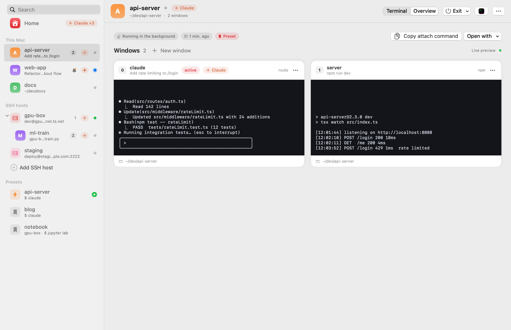

# Initia

**A tmux-native terminal for macOS.** Browse every tmux session, watch it live, and work in it from a built-in terminal. Or open it in iTerm2, Terminal or cmux with one click.

> Status: **public beta**, free during the beta.

<picture>
  <source media="(prefers-color-scheme: dark)" srcset="screenshots/home-dark.png">
  
</picture>

<table>
<tr>
<td><picture>
  <source media="(prefers-color-scheme: dark)" srcset="screenshots/overview-dark.png">
  
</picture></td>
<td><picture>
  <source media="(prefers-color-scheme: dark)" srcset="screenshots/ssh-host-dark.png">
  
</picture></td>
</tr>
<tr>
<td align="center">Live overview of every window</td>
<td align="center">Remote tmux sessions over SSH</td>
</tr>
</table>

## Features

- **Home**: a start screen with a card for every session, live previews, and a summary of what's running
- **Built-in terminal**: open any tmux session in a real terminal inside Initia, with a tab for each one. Closing a tab only detaches. Plain terminals without tmux work too (⌘T)
- **Claude Code aware**: see which sessions run Claude and whether it is working or waiting. Get a notification when Claude finishes, and quit it cleanly with **Exit** (`/exit`, then end the session)
- **SSH hosts**: your `~/.ssh/config` hosts in the sidebar. Connect (key or password) to browse and open their tmux sessions, and add or edit hosts in the app
- **Snippets**: one-click buttons under the terminal that type text for you (`/clear`, `/compact`, …)
- **Manage tmux**: create sessions; rename sessions and windows; create and close windows
- **Open anywhere**: iTerm2, Terminal, cmux, Ghostty, WezTerm, kitty, Alacritty
- **Presets and autostart**: save a device, folder and startup command, and bring your sessions up at login
- **Automatic updates**: Initia checks for new versions and updates itself in one click. Your tmux sessions keep running
- **Menu bar and Dock**, English and Korean UI

## Install

Requires macOS 15 or later (Apple Silicon or Intel) and [tmux](https://github.com/tmux/tmux) (`brew install tmux`).

```sh
curl -fsSL https://raw.githubusercontent.com/hyeok-jong/Initia/beta/install.sh | bash
```

The script downloads the latest release, verifies its checksum, and installs Initia to `/Applications` (or `~/Applications`).

**Manual install:** download `Initia-<version>.zip` from [Releases](https://github.com/hyeok-jong/Initia/releases) and unzip it into `/Applications`. Initia is not notarized by Apple yet, so the first launch is blocked. Allow it in **System Settings → Privacy & Security → Open Anyway**, or run:

```sh
xattr -dr com.apple.quarantine /Applications/Initia.app
```

## Presets

A preset is a session you start often: a device, a folder, and a startup command. Start it in one click from Home, or mark it **autostart** to bring it up when Initia launches. A new install comes with an `example` preset that opens Claude Code in your home folder; edit or delete it in the sidebar.

Presets are stored in `~/.config/initia/config.json`, so you can also write them by hand:

```json
"presets": [
  { "name": "api-server", "path": "~/dev/api-server", "command": "claude", "autostart": true },
  { "name": "notebook", "path": "~/research", "command": "jupyter lab", "device": "gpu-box" }
]
```

`device` is a `Host` name from `~/.ssh/config`. Leave it out for this Mac.

## Configuration

Settings live in `~/.config/initia/config.json`. Open the Settings window with ⌘,.

**Logs:** errors and warnings go to `~/Library/Logs/Initia/initia.log`. Open the log viewer with ⇧⌘L.

**SSH:** Initia reads hosts from `~/.ssh/config`. When you edit a host in Initia, only the lines you change are rewritten, and the previous file is kept as `~/.ssh/config.initia-backup`. Initia never stores passwords: if a host needs one, you log in once in a terminal tab and Initia reuses that connection for 30 minutes.

**cmux:** by default, cmux accepts socket connections only from processes it started itself. To let Initia open workspaces in cmux, go to cmux **Settings → Automation**, set socket access to `password`, and enter the same password in Initia under **Settings → Terminals**.

## Feedback

Report bugs and request features in [Issues](https://github.com/hyeok-jong/Initia/issues).

## License

Initia is proprietary software, free to use during the beta. See [LICENSE](LICENSE).
